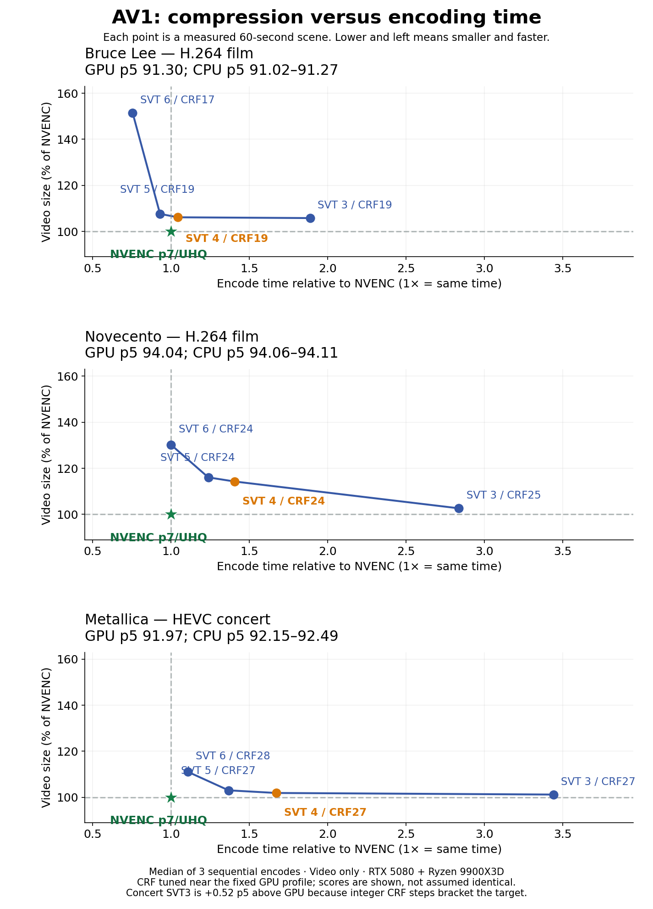

# AV1 CPU presets versus the production GPU profile

Measured locally on 2026-10-20 with the RTX 5080, Ryzen 9900X3D (24 logical
CPUs), project FFmpeg 9.0.2 / SVT-AV1 4.2.0, and NVIDIA driver 617.42.
Use **NVENC p7/UHQ/CQ34/QP0–100 for the main library pilot**. For optional CPU
work, **preset 4 is the balanced choice**; preset 3 spends roughly twice the
CPU time for a small or content-dependent size gain. Presets 5 and 6 remain
available when their speed is worth the measured storage trade-off.



## Method

Three 60-second SDR scenes came from the selected large local sources: the
weak Bruce Lee minute at 1588.557 s, Novecento's difficult minute at 1080 s,
and the concert LED-wall minute at 8221.275 s. Each encoder reads the same
source interval with the worker's CPU width filter and 10-bit format. The GPU
baseline is the **actual production video recipe**, including CQ34 and paired
`-qmin 0 -qmax 100`. Audio and subtitles are excluded here. These are scene
results, not whole-movie size or time projections.

SVT presets 3–6 use independently selected integer CRFs, targeting the fixed
GPU profile's p5 within approximately 0.3 point and never selecting a p5 below
91. This tolerance avoids paying a whole CRF step for tiny score differences.
On the concert, preset 3's adjacent CRFs bracket the target: the selected point
is 0.52 above GPU; the cheaper point is reported separately below. The scores
are similar rather than identical, and matching p5 does not establish identical
mean VMAF, grain, texture, or subjective quality.

VMAF scores every frame against the existing lossless source reference, with
both timelines reset to start at zero. Reference, output, and scored frame
counts must match. Every selected encode has three sequential timing runs;
reported time is the median, excluding VMAF and frame counting. No other
encode ran concurrently. Encodes, raw command vectors, logs, and per-frame
scores are retained locally under
`build/av1-lab/plex/large-source-benchmark/cpu-preset-followup/` in the primary
checkout. The [selected measurements](benchmarks/av1-cpu-presets.csv) include
all three timings; [all calibration trials](benchmarks/av1-cpu-preset-trials.csv)
retain the other measured quality points.

## Measured points

All sizes below are decimal MB of video packet payloads in one minute.

| Scene | Encoder | CQ / CRF | Video MB | p5 VMAF | Median encode s |
| --- | --- | ---: | ---: | ---: | ---: |
| Bruce Lee | NVENC p7/UHQ | 34 | 6.544 | 91.304 | 12.60 |
| Bruce Lee | SVT preset 3 | 19 | 6.924 | 91.168 | 23.77 |
| Bruce Lee | SVT preset 4 | 19 | 6.946 | 91.114 | 13.14 |
| Bruce Lee | SVT preset 5 | 19 | 7.043 | 91.015 | 11.71 |
| Bruce Lee | SVT preset 6 | 17 | 9.911 | 91.270 | 9.51 |
| Novecento | NVENC p7/UHQ | 34 | 28.636 | 94.042 | 11.15 |
| Novecento | SVT preset 3 | 25 | 29.391 | 94.096 | 31.61 |
| Novecento | SVT preset 4 | 24 | 32.725 | 94.107 | 15.66 |
| Novecento | SVT preset 5 | 24 | 33.236 | 94.084 | 13.79 |
| Novecento | SVT preset 6 | 24 | 37.283 | 94.057 | 11.15 |
| Concert | NVENC p7/UHQ | 34 | 124.203 | 91.966 | 14.95 |
| Concert | SVT preset 3 | 27 | 125.690 | 92.486 | 51.43 |
| Concert | SVT preset 4 | 27 | 126.540 | 92.247 | 24.99 |
| Concert | SVT preset 5 | 27 | 127.962 | 92.221 | 20.44 |
| Concert | SVT preset 6 | 28 | 137.951 | 92.150 | 16.55 |

## What to choose

Preset 4 took **45–51% less time than preset 3**, with **0.3–11.3% more video
bytes** in these selected points. Preset 5 was faster again and used about
1.7–13.1% more video than preset 3. Preset 6 used about 9.8–43.1% more video
than preset 3; it is a speed-oriented option rather than the compression
choice for this workload. These ranges describe three scenes, not a forecast
for the library.

At the closely matched points, production NVENC used fewer video bytes than
the selected CPU points and generally less time. The fastest CPU settings
approached or beat GPU time on some scenes by spending more bytes. CPU encoding
is functional, but it does not guarantee smaller files at the same measured
quality. The older CQ33/HEVC-relative projections used different GPU settings;
use this comparison for the current CQ34/QP-cap recipe.

There are useful cheaper concert points **within the requested p5 91–92 band**:

| Concert choice | Video MB | p5 | Encode s (one calibration run) | Saving vs fixed NVENC video |
| --- | ---: | ---: | ---: | ---: |
| NVENC CQ34/QP0–100 | 124.203 | 91.966 | 14.88 | Reference |
| SVT preset 3 / CRF28 | 116.298 | 91.315 | 56.57 | 6.4% |
| SVT preset 4 / CRF28 | 116.988 | 91.052 | 25.07 | 5.8% |
| SVT preset 5 / CRF28 | 118.373 | 91.052 | 20.67 | 4.7% |

These CPU rows have lower p5 than the GPU baseline; the savings are not at
identical quality. They show why preset 4 or 5 can be a useful CPU option,
while preset 3's extra time buys little on this particular minute. A different
concert peak failed the absolute p5 target even with current x265, so this
one-minute result does not approve the entire concert or every HEVC title.

The worker's omitted CPU preset remains the compression-oriented **3 / CRF23**.
The [deployment example](worker-deployment.md) now explicitly selects **4 / CRF23**
as a balanced override. Presets and CRF are independent: the calibrated CRFs in
this table are per-scene measurements, not proposed universal worker defaults.
The fixed profile has no VMAF prepass or automatic CRF retry. Preserve originals
and review complete outputs during the pilot. Mixed four-GPU/two-CPU throughput
and wall-plug energy have not been measured.

## Reproduce

Use `scripts/av1_cpu_presets.py` with a JSON array such as:

```json
[
  {
    "title": "Example film",
    "source": "/media/input.mkv",
    "reference": "/lab/lossless-60s-reference.mkv",
    "start": 600,
    "initial_crf": 23
  }
]
```

The reference must contain the exact decoded 60-second interval. This follow-up
uses SDR inputs no wider than 1920 pixels. Use a fresh output directory when
changing inputs, references, encoder builds, or command construction. Exact
commands are recorded with every point. Existing matching records and timing
runs let an interrupted run resume.

```bash
python3 scripts/av1_cpu_presets.py --manifest /lab/scenes.json \
  --output /lab/cpu-presets --ffmpeg /path/to/project/ffmpeg \
  --duration 60 --repeats 3 --p5-tolerance 0.3
```

The [complete server/worker movie test](av1-worker-profile-validation.md)
provides the actual whole-file and application-time result; it is separate
from these video-only scene measurements.
